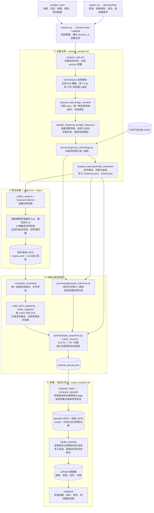
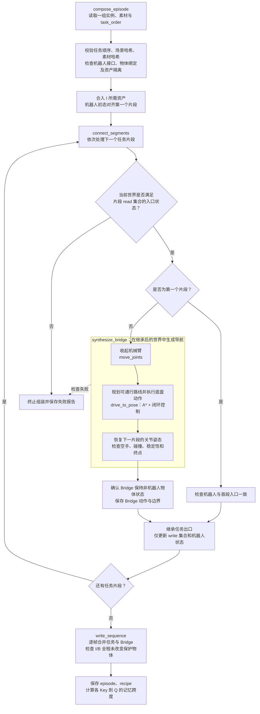

# Memory Bench 代码流程

`memory_bench` 的核心是构建记忆任务数据：采集 Key → Query 的连续操作，再加入干扰任务，通过物理导航连接各片段，最终重新渲染并导出 LeRobot 数据。

- **K（Key）**：提供需要记住的信息。
- **I（Intervent）**：插入的干扰任务。
- **Q（Query）**：依赖前面信息完成的任务。
- **B（Bridge）**：连接两个任务的机器人导航片段。

## 整体流程

准备阶段会标记实例是否仍需物理标定；采集入口还会检查实例状态。采集时只录制 K/Q，最终任务顺序中的 I 和 B 在后处理阶段加入。

## 核心拼接逻辑

这部分对应 [compose_episodes.py](../episodes/compose_episodes.py)。每个片段只更新自己的 `write` 集合和机器人状态，其他物体继续继承此前结果。

一条典型产物是 `K → B → I₁ → B → I₂ → B → Q`；也允许 I 出现在 K 前面，顺序须满足配置中的依赖，Q 始终在最后。

Bridge 使用物理仿真执行动作；最终渲染按记录状态逐帧恢复，不推进物理。

## 主要代码入口

| 文件 | 职责 |
| --- | --- |
| [session.py](../session.py) | 加载配置、查找任务、校验依赖和顺序 |
| [tasks/base_task.py](../tasks/base_task.py) | 任务变体、绑定、指令及实时条件检查 |
| [collection/prepare_task.py](../collection/prepare_task.py) | 初始化、变体分配、实例组装 |
| [collection/sample_instances.py](../collection/sample_instances.py) | 完整场景与入口姿态采样 |
| [collection/collect_session.py](../collection/collect_session.py) | 联合遥操采集与片段边界管理 |
| [utils/recordings.py](../utils/recordings.py) | 录制元数据、逐帧状态读取与素材检查 |
| [utils/segment_manifest.py](../utils/segment_manifest.py) | 片段加载、边界对齐、接口及源文件哈希校验 |
| [utils/scene_state.py](../utils/scene_state.py) | 场景状态访问、比较与合并 |
| [processing/scan_recordings.py](../processing/scan_recordings.py) | I 素材扫描与清单生成 |
| [processing/split_recordings.py](../processing/split_recordings.py) | 调用规范化与 K/Q 切段 |
| [processing/prepare_intervent.py](../processing/prepare_intervent.py) | I 素材规范化、审计与筛选 |
| [episodes/pair_segments.py](../episodes/pair_segments.py) | 分配顺序并保存素材组 |
| [episodes/compose_episodes.py](../episodes/compose_episodes.py) | 状态继承、Bridge 连接与 episode 拼接 |
| [episodes/synthesize_bridges.py](../episodes/synthesize_bridges.py) | 物理导航片段合成与世界状态保护 |
| [navigation.py](../navigation.py) | 路径规划、底盘闭环控制和关节运动 |
| [episodes/render_episodes.py](../episodes/render_episodes.py) | 状态回放渲染、LeRobot 导出及读回检查 |
| [tools/debug_intervents.py](../tools/debug_intervents.py) | 独立 I/Bridge 拼接与导出调试 |
| [tools/audit_world.py](../tools/audit_world.py) | 继承场景中的物理可行性审计 |
