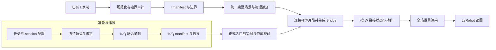

# 分开调试采集与拼接

整体需求以 [benchmark_design.md](benchmark_design.md) 为准。本轮只验证一组真实素材、一种顺序和一条最终 `I1 → Bridge → I2` episode，标记为 `intervent_debug`。它不包含 K/Q，不作为正式记忆任务或 150 条数据的验收。

按最新调试要求，本轮先只导出 RGB 供查看，暂不生成深度。动作、指令和本体状态元数据仍保留，读回按实际 RGB 相机接口验收。

## 两部分的阅读顺序

| 部分 | 建议顺序 | 交付给下一步的内容 |
| --- | --- | --- |
| A：准备与遥操 | `session.py`、任务定义及 YAML → `collection/prepare_task.py` → `collection/sample_instances.py` → `collection/collect_session.py` → `processing/normalize_recording.py`、`make_segments.py` | 冻结实例完整场景、真实绑定、K/Q 联合录制、marks、规范化状态、各段 manifest 与边界快照 |
| B：素材与拼接 | `processing/debug_intervents.py` → `recordings.py`、`prepare_intervents.py` → `compose_episodes.py` → `synthesize_bridges.py`、`navigation.py`、`utils/navigation_map.py` → `render_episodes.py` | I manifest、统一场景、真实 Bridge、assembly、recipe、拼接 HDF5、LeRobot 数据及读回报告 |

建议先打开一份 `segment.json` 理解片段接口，再沿当前失败阶段的输入追代码。`compose_episode()` 保留正式 K/Q 的实例、依赖和保护校验；`connect_segments()` 与 `write_sequence()` 是两条入口共用的导航衔接和状态拼接逻辑。



## 片段交接接口

- `identity`、`task`：逻辑片段 ID、角色、活动、实际 `room_id`、指令和依赖。
- `source`：原始 HDF5、demo、动作区间、源哈希、fps，以及规范化 HDF5 的引用和哈希。
- `states`：入口和出口的完整快照及状态目录。
- `objects`：任务使用集合 U、读取集合 R、写集合 W，以及记忆物体绑定。
- `interface`：机器人型号、源机器人名字、控制器、动作维度、控制与渲染频率。
- `validation`：真实任务初态/终态、空手和稳定性等检查结果。

动作区间为 `[start,end)`，入口是 `state[start]`，出口是动作后的 `state[end]`。优化录制必须顺序解码，不能只解码末帧。片段通过 manifest 引用原始录制，不修改官方数据。

保存的 JSON 快照同时用于状态比较。`Scene.restore` 和 `recursively_convert_to_torch` 会原地将列表改为 Tensor，送入这些加载器时必须使用副本，保留比较基线的 JSON 类型。遇到大批对象同时不匹配，先核对实际快照与基线的逐字段值及运行时类型，再判断是否发生物理变化。

## 运行一条独立序列

先激活预装 `behavior` 环境。在仓库根目录运行：

```bash
bash memory_bench/scripts/debug_intervents.sh
```

脚本顶部设置配置路径、GPU、`STAGE` 和 `RGB_ONLY`；默认 `all` 按顺序执行所有阶段，`RGB_ONLY=true` 在渲染时跳过深度。配置为 `memory_bench/configs/debug_intervents.yaml`，其中设置两条源录制、完整稳定场景、通道门、阈值、相机和独立输出根目录。脚本使用当前 `python`，不安装或选择环境。

分开运行时修改脚本顶部 `STAGE`，或直接调用同一 Python 入口：

```bash
python -m memory_bench.processing.debug_intervents memory_bench/configs/debug_intervents.yaml prepare
```

已完成拼接后，只运行 RGB 渲染：

```bash
python -m memory_bench.processing.debug_intervents memory_bench/configs/debug_intervents.yaml render --rgb-only
```

此参数只改变本次渲染的模态，不修改已冻结的素材和 session 配置；实际参数保存于 `export_contracts/<episode>.json`。读回无需再加该参数，直接检查本次实际输出的相机。

| 阶段 | 读取 | 保存与检查 |
| --- | --- | --- |
| `prepare` | 固定的两条真实 HDF5 | 检查共同场景、不同房间、资产隔离及接口；规范化、物理边界审计，生成 I manifest 和资产清单 |
| `scene` | 完整 stable 场景、两段入口 | 补入明确允许的 I 资产及首段机器人；预开通道门，在正常物理下稳定场景并检查入口兼容，保存 `world.json` |
| `audit` | `world.json`、两段真实轨迹 | 每段抽取入口、四分之一、中点、四分之三和末动作，在累计世界中执行真实动作；检查机器人与任务外背景的碰撞及背景状态保持，保存 `world_audit.json` |
| `bridge` | `world.json`、两个 I manifest | 在继承 I1 结果后的世界中收臂、导航、展臂；检查碰撞、世界保持及 I2 入口，保存 Bridge 和 `assembly.json` |
| `compose` | 已完成的 assembly 与 manifest | 复核源哈希，按 W 和机器人逐帧继承，保存唯一拼接 HDF5、完整回放起点及 recipe |
| `render` | 该条拼接 HDF5、recipe、完整起点 | 全房屋逐帧重渲染，保存同一条 LeRobot episode、各段首帧快照和注释 |
| `readback` | 同一条 LeRobot episode 和源配方 | 逐帧核对动作、关节观测、指令、时间戳、全部预期视频，并检查实际导出注释与边界快照，保存报告 |

正常产物位于配置的 `paths.output_root`，当前默认是 `/data/bwang/code/BEHAVIOR-1K/outputs/memory_bench/1015_compose_nearby_v2`，session 名为 `debug_intervents_1015_nearby`：

```text
sessions/debug_intervents_1015_nearby/   # 配置、资产、段索引、world、assembly
segments/debug_intervents_1015_nearby/   # 两段规范化录制和真实边界
bridges/debug_intervents_1015_nearby/episode_00000000/
episodes/debug_intervents_1015_nearby/episode_00000000.hdf5
recipes/debug_intervents_1015_nearby/episode_00000000.json
lerobot/debug_intervents_1015_nearby/    # data、videos、annotations、segment_states
reports/debug_intervents_1015_nearby/   # 各阶段检查与错误
```

输出配置冻结后不得改写；要换源素材或配置，使用新的输出根目录。已生成的 Bridge、拼接序列和导出数据拒绝覆盖。后续阶段直接读取对应中间产物，渲染失败无需重新合成导航。不要并发运行同一输出目录的阶段。

### 当前选择：邻近房间与短任务

当前 YAML 已改为 `house_double_floor_lower` 的 `turning_on_radio`（task-0000，living_room_0）与 `hanging_pictures`（task-0034，kitchen_0），新 session 为 `debug_intervents_1015_nearby`，新输出根目录为 `/data/bwang/code/BEHAVIOR-1K/outputs/memory_bench/1015_compose_nearby_v2`。上面的目录结构保持一致，实际子目录名使用新 session。

两任务使用集合不相交，无粒子系统，完整 stable 场景共 260 个对象，合并素材后共 263 个对象。已选录制的 I1 出口与 I2 入口相距约 4.06 米，房间之间无需开通道门。挂画放在最后，除源任务终态检查外，还要核对导出末观测中的附着状态及海报位置。

已从 [2026 原始录制](https://huggingface.co/datasets/behavior-1k/2026-challenge-rawdata) 下载以下候选，不必下载整个任务目录：

- `task-0000/episode_00000010.hdf5`、`episode_00000020.hdf5`、`episode_00000030.hdf5`。
- `task-0034/episode_00340020.hdf5`、`episode_00340030.hdf5`、`episode_00340040.hdf5`。

这六条已下载到 `/data/bwang/datasets/2026-challenge-rawdata/` 下对应任务目录，共 48,913,939 字节，接口一致且都有动作后的末状态。配置选择 `episode_00000010`（1,956 动作）和 `episode_00340040`（2,816 动作），均已通过真实入口、任务终态、空手及稳定性检查。合并世界已连续稳定 30 步，10 个代表动作全部通过物理抽查。最短的挂画候选 `episode_00340020` 没有完成任务，末状态海报在地上且未附着；其失败检查保留在 `1015_compose_nearby`，不能因片段短而采用。终止标记本身不能替代物理验收。

本次 Bridge 已通过物理终点检查，共 4,702 动作。原 4,699 动作已完成导航，但展臂返回时夹爪速度仍为 0.252；从真实出口快照追加 3 个保持动作后，受控关节最大速度降至 0.001738，终点位置误差 0.015365 米。原入口文件及前缀的动作、状态、state_size、reward、terminated、truncated 均逐值一致。详见 `reports/debug_intervents_1015_nearby/bridge_continuation.json`。该结果属于显式保存状态续录；本次完整 RGB 重渲染和实际 LeRobot 逐帧读回也已分别通过。

拼接产物共 9,474 动作和 9,475 状态，30 Hz，时长约 315.8 秒。三个区间为 I1 `[0,1956)`、Bridge `[1956,6658)`、I2 `[6658,9474)`，动作与源录制逐值一致，Bridge 指令使用下一任务的 `hanging pictures`。`composition_checks.json` 验证收音机从 I1 出口直到最终状态持续开启，最终海报附着到原墙钉 UUID 4575654。这部分是标准状态的离线检查；本次实际导出另由 `export_readback.json` 和 `rgb_video_checks.json` 验收通过。

### 本次 RGB 验收结果

2026-10-16 已完成唯一一条 `I1 → Bridge → I2` 的完整 RGB 重渲染、LeRobot 逐帧读回和三路视频独立全流解码。每路均为 9,474 帧、30 FPS；头部 RGB 为 720×720，左右腕 RGB 各为 480×480，总时长 315.8 秒。

动作、指令、时间戳及配置中的关节位置和速度字段逐帧对齐，三个片段首帧和最后已有观测均与累计世界一致。末观测明确对应 `state[9473]`，收音机保持开启、海报附着 UUID 为 4575654，海报位置与记录一致；不另加训练帧表示动作后的 `state[9474]`。

已通过 74 项离线回归测试、相关代码 Ruff 检查、入口脚本语法检查及差异检查。视频首尾预览 PNG 与最终封装的 HEVC 逐像素一致，已抽看导航结束、挂画完成及双腕末帧。H.264 查看副本来自同一条头部视频，不构成第二条训练 episode。

- [完整头部 RGB 查看副本](../../outputs/memory_bench/1015_compose_nearby_v2/reports/debug_intervents_1015_nearby/rgb_preview/head_full_rgb.mp4)
- [验收汇总](../../outputs/memory_bench/1015_compose_nearby_v2/reports/debug_intervents_1015_nearby/acceptance.json)
- [LeRobot 逐帧读回](../../outputs/memory_bench/1015_compose_nearby_v2/reports/debug_intervents_1015_nearby/export_readback.json) 与 [完整视频检查](../../outputs/memory_bench/1015_compose_nearby_v2/reports/debug_intervents_1015_nearby/rgb_video_checks.json)

本轮不包含深度或 K/Q。代表动作物理抽查和保存状态续录的范围见下文，不据此宣称正式记忆有效性或 150 条批量数据已经验收。

旧 `1015_compose_v2` 保留原 task18/19 的规范化、物理检查和失败诊断；长距离 Bridge 第 7 轮按用户要求停止，归档于 `failed/bridge_07_user_cancelled/`，不作为通过的导航结果。

失败时先查看 `reports/<session_id>/<stage>_failure*.json` 的调用栈，再沿该阶段表中的输入检查；重复失败另存编号报告。物理抽查的失败样本还会保存对象变化前后的值，初始零时间缓存刷新另记在 `initial_cache_refresh`，便于区分派生缓存更新和动作后的实际变化。

准备素材时先保存 `source.json` 的源路径、demo 和哈希；规范化完整写完动作及末状态后才标记 `normalization_complete`。若后续边界审计失败，重新运行 `prepare` 可以核对来源并复用完整规范化文件。未完整写完的文件拒绝复用；将失败目录移到独立保留位置后再重跑。完整阶段已有产物时，选择下一个 `STAGE` 继续，不重复执行 `all`。已有不完整导出也需先移到独立保留位置，再对同一条拼接序列重跑 `render`。

`audit` 是代表点的物理操作检查，不是全轨迹可执行性证明。它检查机器人与任务外背景的碰撞，并检查任务写对象是否接触合并后新增、移动或更换模型的背景；源素材中身份与状态保持一致的背景允许保留原有地面和支撑接触。背景仍参与状态保持检查。失败抽查保存在 `world_audit_attempts/`，可以重跑；只有通过后才保存 `world_audit.json`。Bridge 阶段要求检查报告通过，且报告的世界与 manifest 哈希对应当前输入。

Bridge 的采集器关闭仅记录活动对象的过滤，确保每步世界检查和录制都包含静态、休眠背景。此设置只影响记录完整性，不改变物理行为。渲染时先加载当前 W 和机器人的语义状态，再单独恢复记录中的运动学状态，避免首次创建附着关系时自动对齐物体而改变记录姿态。完成零时间 FK、缓存和视觉刷新后，直接渲染并读取观测，不推进物理或清零记录速度。每条结果的 `export_contracts/<episode>.json` 记录实际相机、渲染参数、回放方式和机器人关节接口。读回核对本次每路视频的尺寸、FPS 和全部解码帧，将关节位置、速度与拼接源状态逐帧比较，并检查已保存注释和累计 W 的边界快照。

预期模型相机从机器人原始 USD 资产读取，再按与机器人加载器相同的过滤、计数和尺寸规则核对实时传感器。运行期间额外出现的辅助 Camera 不能直接算作模型传感器；缺少原始模型相机仍会报错。没有模态且不进入观测的外部预览相机不创建；其他外部相机保留，匿名相机沿用原配置下标的默认身份。每帧执行配置次数的 `og.sim.render()`，随后由 `env.get_obs()` 取得真实传感器观测。

`_render_observation()` 在零时间 FK 后使用 PhysX Fabric 的 `force_update(physics_dt, current_time)`，再更新 Fabric 层级矩阵缓存，保证机器人附属相机读取当前姿态。普通缓存更新在相同物理时间可能跳过写入；只加层级刷新也可能滞后一帧。GPU 探针已检查三路相机的起点、末点和往返切换，并比较 260 个背景对象，确认状态和物理时间均不变；详见 `visual_replay_preflight.json`。每帧还检查物理步号，发现意外推进即拒绝导出。

首次完整 RGB 尝试已生成 9,474 帧，真实读回在末快照拒绝了海报沿墙面法线约 0.02458 米的位移，超过原有 0.02 米容差。其附着 UUID 正确，但 `env.step()` 的物理推进和首次附着的自动对齐不能保证记录位姿；失败导出完整保存在 `render_attempts/rgb_physics_step_01/`。修复采用上述纯渲染顺序，先以末帧进行真实 GPU 预检，再恢复整个初态重新渲染同一条；不放宽容差、不改标准状态，也不以改写快照代替重渲染。

初版纯渲染虽恢复了正确状态，但画面仍停留初始视角，在 600 帧时停止并归档到 `render_attempts/rgb_pure_render_01/`。因此，末帧状态通过不能替代真实图像检查；预检须同时验证相机画面与状态，再放行完整渲染。

相机内参和 OmniGibson git hash 保存在 `meta/omnigibson.json`，标准 `meta/info.json` 交由 LeRobot 管理，适配当前固定字段的 `DatasetInfo`。读回检查每路实际视频都有有限、有效的 3×3 内参及非空版本信息。已有点云与 benchmark 读取脚本优先读新文件；旧数据则直接从原始 `info.json` 取扩展字段，避免 typed loader 丢弃未知键。

渲染还保存每条 episode 的 `segment_states/<episode>/last_observation.json`，由导出注释中的 `last_observation_snapshot` 引用。它明确对应最后已有观测 `state[N-1]`，不增加训练帧，也不代替最后动作后的 `state[N]`。读回会核对其累计 W、机器人、绑定和帧索引，可检查挂画后的附着状态及前序收音机结果在最后画面中仍被保留。

采集器的默认 reset 会推进物理，因此 Bridge 在 reset 完成记账后、任何动作发出前恢复定义好的继承入口，并同步重建录制的第 0 帧。之后不再恢复入口，导航全程执行真实动作与世界检查。逐动作快照保留完整对象、系统及机器人状态，静态场景元数据复用入口保存；入口和出口仍完整保存场景。失败报告位于 `bridge_attempts/<bridge_id>_<编号>.json`，记录原始异常、动作数、最近一次世界检查快照和实际接触对。调试入口将失败 HDF5 和边界文件归档至同编号目录，独立 CLI 随后直接退出。成功路径保留场景清理，供同进程的 Bridge 规范化复用。

展臂的最终目标同时检查关节位置、关节速度和底盘速度，到位后仍在运动就继续记录真实保持动作。若归档唯一失败为最后的速度检查，独立调试入口允许显式指定 `bridge --resume-attempt <失败报告路径>`。它保留原稳定入口和全部动作，核对来源、计数、世界、目标及恢复后的速度，再从保存的真实出口续录；碰撞、世界变化、未到目标等失败不支持续录。HDF5 采集器省略的 `state[N]` 从真实出口快照补回，不使用最后动作之前的状态替代。续录区间及本次读入文件的哈希写入 Bridge manifest，原失败归档保留。

这属于保存状态的物理续录；快照不包含全部 PhysX 求解器内部缓存，不代表原进程从未中断。恢复时不清零速度，逐动作碰撞和世界保持检查继续生效，最终仍需通过完整入口、出口、空手、稳定性及拼接检查。正式流程不启用此调试续录接口。

Bridge 的规划地图默认分辨率为 0.02 米，可用 `bridge.map_resolution` 覆盖。收臂后，以实际机器人 AABB 相对底盘的位置构造非对称占地范围，并加上位置跟踪容差。R1 全向平移时保持入口朝向，到达精确终点后再对齐目标朝向，避免为相邻格点或拐角反复转身。A* 只为实际访问的格点分配分数；合并直线时保留路径转角。

实时占据范围逐个碰撞 mesh 叠加，不能将复合 link 的总包围盒直接填满。`house_double_floor_lower` 的庭院铺地 link 包含 15 个独立凸碰撞网格，总包围盒覆盖室内孔洞，曾误封两个室内端点；实际网格包围盒的并集保留全部障碍与空隙。保留相同机器人占地和 2 厘米余量后，地图恢复连通；真实碰撞与世界守卫继续验收。相关实际网格、旧地图逐像素复算和修正对比保存在 `navigation_probe_01/`。

导航诊断曾发现两类独立问题：0.1 米网格膨胀切断窄门；0.05 米居中膨胀虽连通，却不足以覆盖机器人偏心占地及转身范围。第 6 轮在起点附近的大幅转向后平移触发碰撞，失败快照中机器人 AABB 与床重叠，尚未到达通道。0.02 米地图上的实际固定朝向占地加 0.02 米跟踪裕量离线连通，终点转向的采样 AABB 检查无背景重叠候选。这些是规划诊断，真实逐动作碰撞、状态和终点检查通过后，才可接受 Bridge。

每个采样点只恢复当前 I 的使用对象和机器人，背景在正常物理下继承；任务交接只恢复真实出口的 W 和机器人。检查同时比较单步变化和相对固定继承基线的累计变化，基线只在任务交接时更新该 I 的 W。审查要求关闭跳过对象的隐式稳定化，避免部分加载时冻结背景。反复恢复整屋会唤醒无关物体，不能用这种扰动代替真实继承过程。

场景稳定化最多运行 300 步，要求连续 30 步的全部非机器人状态相对同一候选基线保持在原容差内，同时满足已有线速度、角速度和关节速度阈值。报告记录实际步数和速度；超限直接失败。稳定化后仍检查 I 的读取初态，并通过重新加载后的 `audit` 和导航期间的状态检查继续验证。

调试配置显式给派生 AABB 坐标使用与 `pos` 相同的 0.02 米空间预算。初次物理抽查中，唯一背景变化为客厅落地灯的约 2.32 毫米位置调整、3.52 毫米包围盒调整，均无碰撞；AABB 是位姿派生缓存，先前误用了其他数值字段的默认 0.001 阈值。原始失败记录保留在 `1015_compose`，新配置冻结在 `1015_compose_v2`，依据记录于 `state_tolerance_calibration.json`。其他位姿、关节、语义状态和碰撞检查未改；此空间预算仍属于调试配置，不能据此宣称已完成正式任务的物理标定。

旧样例使用任务 18 的 `episode_00180020.hdf5/demo_0` 和任务 19 的 `episode_00190010.hdf5/demo_0`，分别为 10,081 和 10,178 个动作，均为 23 维、30 Hz，且都有动作后的末状态。源文件只包含任务房间相关物件和公共结构，完整世界来自官方 stable 场景。卧室与杂物间距离过远，该组合已停止继续导航；其物理准备和诊断产物保留作参考。

## 接回真实 K/Q

A 调通后，使用其冻结场景、实例绑定和 K/Q manifest，与通过检查的 I manifest 一起交给正式 `pair_sources`、`compose_episode` 和导出入口。正式流程继续检查唯一 Q、完整 Key 依赖、合法顺序、实例对应、记忆保护、变体与顺序独立性，以及正式数量。

K/Q 的联合采集转场不进入最终序列；在当前世界中重新生成相邻任务的 B。首段可以是 I，正式场景中的机器人身份保持一致，不以首个 I 的源别名替换它。

I/Bridge 调试没有记忆答案和记忆距离，recipe 的 `memory_spans` 为空。接回真实 K/Q 后仍需验证记忆物体身份与状态继承、Q 的记忆依赖及答案不泄露。离线回归和 visual-only 视频不能代替真实物理可执行性检查。
